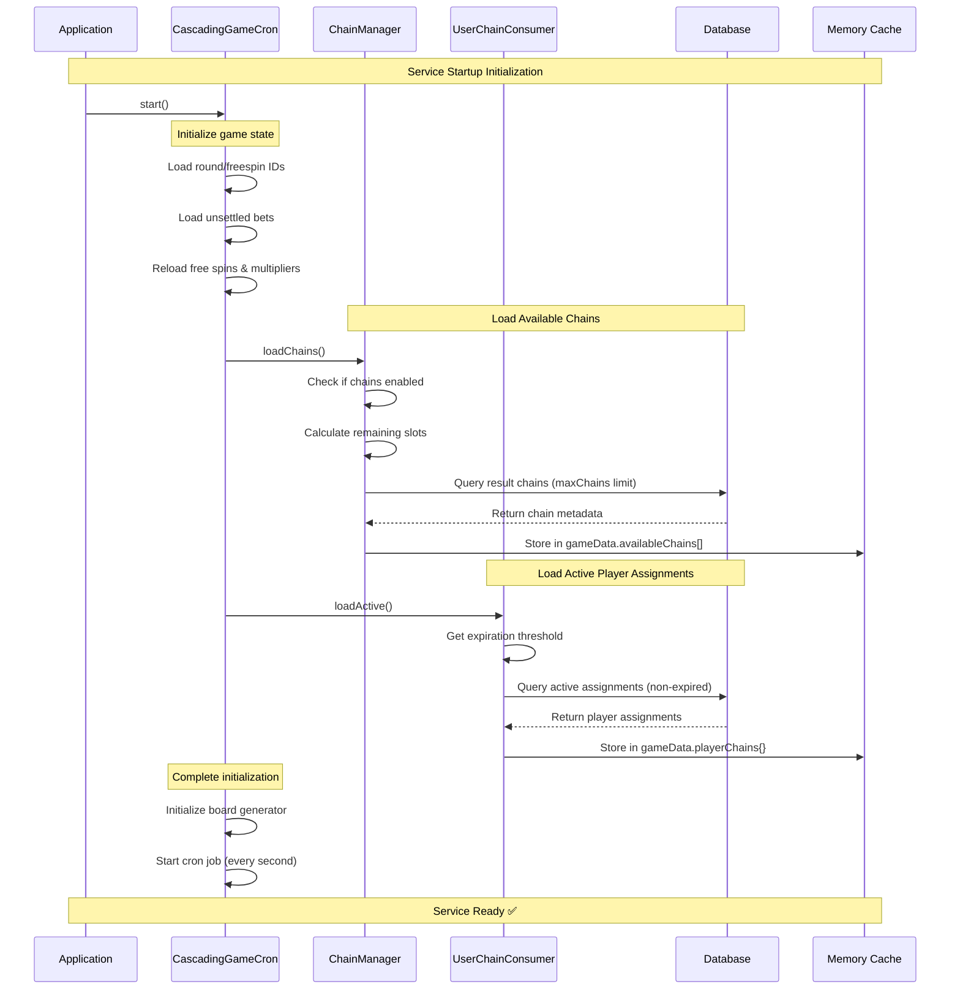
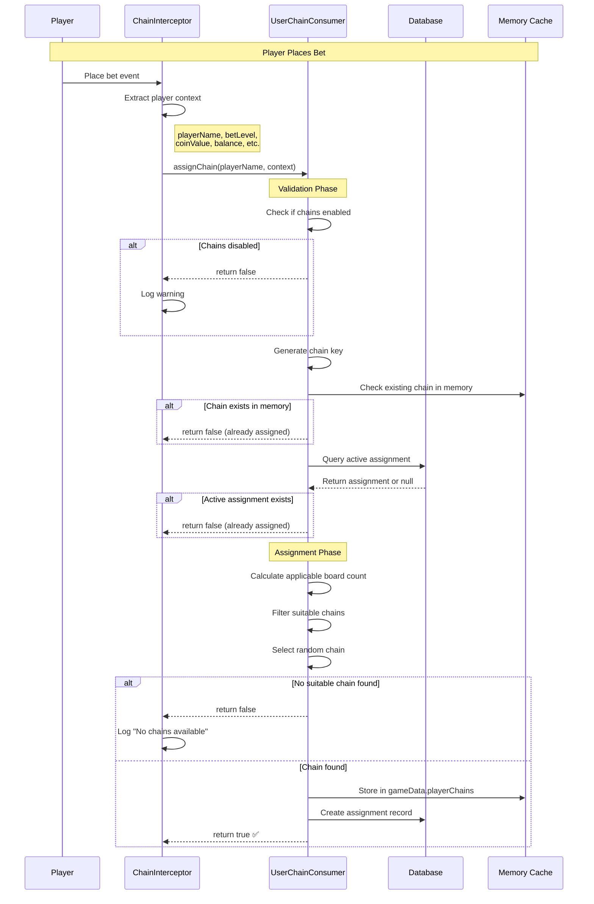
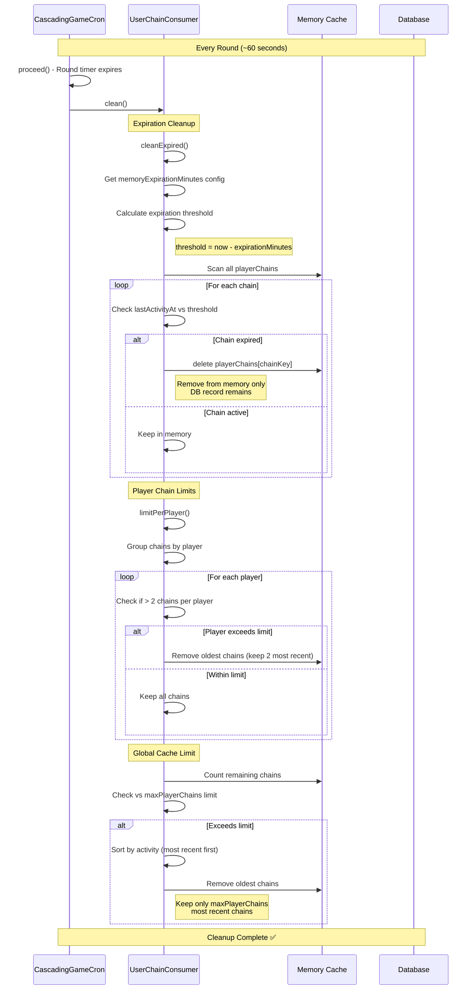
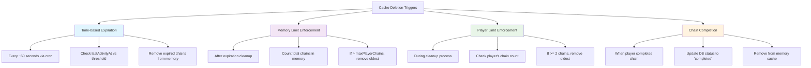

# Cascading Slot Result Chains & Player Tracking - Complete Guide

## Overview

This comprehensive guide covers the complete result chains system for cascading slot games, including:

1. **Result Chains Feature** - Pre-defined game board sequences for controlled outcomes
2. **Player Chain Assignment Tracking** - Persistent tracking of player progress through chains
3. **AssignmentRepository Setup** - Database repository for chain assignment persistence
4. **Integration Guide** - Complete setup instructions for your service
5. **Chain Flow Diagrams** - Visual representation of system operations

## Table of Contents

- [Feature Overview](#feature-overview)
- [Chain Flow Diagrams](#chain-flow-diagrams)
- [Prerequisites](#prerequisites)
- [Setup Guide](#setup-guide)
- [Database Setup](#database-setup)
- [AssignmentRepository Setup](#assignmentrepository-setup)
- [Integration Guide](#integration-guide)
- [API Usage](#api-usage)
- [Schema Reference](#schema-reference)
- [Usage Examples](#usage-examples)
- [Performance & Reliability](#performance--reliability)
- [Monitoring & Maintenance](#monitoring--maintenance)
- [Troubleshooting](#troubleshooting)
- [Migration Guide](#migration-guide)

## Feature Overview

### Result Chains System

The Result Chains feature enables:

- **Deterministic game outcomes** for testing and controlled RTP
- **Pre-defined board sequences** instead of random generation
- **Advanced analytics and AB testing** capabilities
- **Specific gameplay scenarios** for promotions or events

### Player Chain Assignment Tracking

The tracking system provides:

- **Comprehensive progress monitoring** through assigned chains
- **Persistent state management** across sessions and reconnections
- **Financial tracking** of bets, wins, and balances
- **Multi-bet configuration support** (different bet levels per player)
- **Real-time analytics** and reporting capabilities

## Chain Flow Diagrams

### 1. Service Startup Flow



### 2. Chain Assignment Flow



### 3. Chain Expiration Flow



### 4. Cache Deletion Scenarios



## Prerequisites

- Existing cascading slot service using this library
- MongoDB database with appropriate permissions
- Node.js with Mongoose support
- Admin authentication system (for control endpoints)
- **DBA coordination** for database index creation and management

## Setup Guide

### 1. Database Setup

#### Create Required Collections

```bash
# Connect to your MongoDB instance
mongo your-database

# Create result_chains collection
db.createCollection("result_chains")

# Create player_chain_assignments collection
db.createCollection("player_chain_assignments")
```

#### Required Indexes (DBA Managed)

The following indexes should be created by your DBA for optimal performance:

```bash
# CRITICAL: Unique index to prevent duplicate active assignments
db.player_chain_assignments.createIndex(
  { "playerId": 1, "betLevel": 1, "coinValue": 1 },
  {
    unique: true,
    partialFilterExpression: { "status": "active" },
    name: "unique_active_assignment"
  }
)

# Performance indexes for common queries
db.player_chain_assignments.createIndex({ "playerId": 1 })
db.player_chain_assignments.createIndex({ "gameId": 1 })
db.player_chain_assignments.createIndex({ "status": 1 })
db.player_chain_assignments.createIndex({ "assignedAt": -1 })
db.player_chain_assignments.createIndex({ "lastActivityAt": 1 })

# Optional compound indexes for complex queries
db.player_chain_assignments.createIndex({ "playerId": 1, "status": 1 })
db.player_chain_assignments.createIndex({ "status": 1, "lastActivityAt": 1 })
```

#### Add Sample Chain Data

```javascript
// Insert a sample result chain
db.result_chains.insertOne({
  name: "wave-100boards-sample",
  boardsData: [
    {
      board: [
        /* 30 symbols array */
      ],
      multipliers: [1, 1, 1, 1, 1, 1],
      isFreeSpin: false,
      remainingFreeSpins: 0,
      settlementResult: {
        totalWin: 10,
        winningIcons: [],
        // ... other settlement data
      },
    },
    // ... more boards
  ],
  metadata: {
    createdAt: new Date(),
    description: "Sample 100-board wave chain",
  },
});
```

## AssignmentRepository Setup

Update your `CascadingSlotContainerRegistry` class:

```javascript
// Add import for the new repository
import PlayerChainAssignmentRepository from "./repositories/player-chain-assignment-repository.js";

export default class CascadingSlotContainerRegistry extends SlotContainerRegistry {
  // Add repository registration
  registerModels() {
    const definition = this.container.resolve("definition");

    super.registerModels();
    this.container.register({
      roundsRepository: asValue(rounds(definition.configName)),
      freeSpinsRepository: asValue(freeSpins(definition.configName)),
      totalMultiplierRepository: asValue(totalMultipliers(definition.configName)),
      resultChainRepository: asValue(resultChains(definition.configName)),
      // Add the new repository
      assignmentRepository: asClass(resultChains(definition.configName)),
    });
  }

  // Update existing ChainManager registration in registerBoardUtilities
  registerBoardUtilities() {
    this.container.register({
      boardSettings: asValue(defaultDefinition.boardSettings),
    });

    this.container.register({
      tumbleCalculator: asClass(TumbleCalculator),
      roundCalculator: asClass(RoundCalculator).proxy(),
      boardGenerator: asClass(CascadingBoardGenerator).singleton(),
      // ChainManager will automatically receive assignmentRepository via dependency injection
      resultChainManager: asClass(ChainManager).singleton(),
    });
  }
}
```

## Integration Guide

### 1. Container Registry Integration

The `ChainManager` now requires the `assignmentRepository` parameter. With your existing `CascadingSlotContainerRegistry`, this is handled automatically through constructor dependency injection.

**No changes needed to existing registrations!** Awilix automatically:

1. Detects that `ChainManager` constructor expects `assignmentRepository`
2. Finds `assignmentRepository` in the container
3. Injects it when creating the `ChainManager` instance

### 2. Configuration Setup

#### App-Level Configuration (appConfigs)

```javascript
// In your app configuration
const appConfigs = {
  resultChains: {
    // Chain loading limits
    maxChains: 300, // Total chains loaded from database
    maxPlayerChains: 300, // Max active player assignments in memory

    // Memory management
    memoryExpirationMinutes: 30, // Auto-cleanup expired chains

    // Chain assignment logic
    assignment: {
      minPlayableBoards: 50, // Min boards required for assignment
      maxBoards: 100, // Max boards that can be applied
      boardsMultiplier: 0.25, // 25% bonus boards calculation
      boardRange: [50, 75, 100, 125, 150, 175, 200], // Valid board counts
    },
  },
  // ... other configs
};
```

#### Game-Level Configuration (gameConfigs)

```javascript
// In your game configuration
const gameConfigs = {
  gameId: "your-game-id",
  cascadingSlotsConfig: {
    resultChains: {
      enabled: false, // Start disabled for safety
      reload: false, // Force reload chains from database
    },
    betMultiplier: 20, // Used in board count calculation
  },
  // ... other game configs
};
```

### 3. Chain Cache Mechanism

The system implements a sophisticated caching mechanism for optimal performance:

#### Memory Management

- **Shared Board Cache**: `chainBoardsCache` stores board data once, shared across all players
- **Player Chain Cache**: `playerChains` stores individual player progress and assignments
- **Automatic Cleanup**: Expired chains are automatically removed based on `memoryExpirationMinutes`
- **Memory Limits**: `maxPlayerChains` prevents memory overflow

#### Cache Loading Strategy

```javascript
// Chain loading from database
const maxChains = appConfigs.resultChains.maxChains; // 300 chains max
const currentCount = gameData.availableChains.length;
const remainingSlots = maxChains - currentCount;

// Load chains with board count filter
const resultChains = await resultChainRepository
  .find({ totalBoardCount: { $lt: maxChains } })
  .sort({ _id: -1 })
  .limit(remainingSlots)
  .lean()
  .exec();
```

#### Board Data Optimization

- **Centralized Loading**: Board data loaded once in `ChainManager`, not per player
- **Lazy Loading**: Boards loaded only when needed via `getBoardsByChainName()`
- **Shared Access**: Multiple players can use same chain without duplicating board data

### 4. Configuration Validation

The system includes robust validation for all configuration values:

#### Required Configuration Validation

```javascript
// ChainManager validates maxChains
const { maxChains } = this.appConfigs?.resultChains || {};
if (!maxChains) {
  this.logService.logError(`maxChains is not configured in appConfigs.resultChains`);
  return; // Prevents loading chains without proper configuration
}

// UserChainConsumer validates all assignment logic configs
const { minPlayableBoards, boardsMultiplier, maxBoards } = this.appConfigs?.resultChains?.assignment || {};
if (!minPlayableBoards || boardsMultiplier === undefined || !maxBoards) {
  this.logService.logError(`missing configuration in appConfigs.resultChains.assignment`);
  return -1; // Prevents assignment with invalid configuration
}
```

#### Error Handling Strategy

- **Fail-Safe Design**: Game continues even if chain features fail
- **Comprehensive Logging**: All configuration errors are logged with game context
- **Early Validation**: Configuration checked at method entry points
- **Graceful Degradation**: Missing configs prevent chain features but don't crash game

### 5. Event Consumer Integration

The `SettleGameRoundConsumer` automatically receives the updated `ChainManager` through your existing container registry. No additional configuration needed.

## Key Memory Structures

### gameData.availableChains[]

```javascript
[
  {
    name: "chain-name",
    baseBetAmount: 0.1,
    totalBoardCount: 75,
  },
];
```

### gameData.playerChains{}

```javascript
{
  "playerName-0.10": {
    name: "chain-name",
    currentIndex: 5,
    totalBoards: 75,
    assignedAt: Date,
    lastActivityAt: Date,
    betLevel: 1,
    coinValue: 0.10,
    playerId: "player123",
    playerName: "playerName"
  }
}
```

### gameData.chainBoardsCache{}

```javascript
{
  "chain-name": [
    { board: [1,2,3,...], multipliers: [...] },
    { board: [4,5,6,...], multipliers: [...] }
  ]
}
```

## API Usage

### Admin Endpoints

#### Enable Result Chains

```bash
POST /api/admin/result-chains/toggle
Content-Type: application/json
Authorization: Bearer <admin-token>

{
    "enabled": true
}
```

#### Check System Status

```bash
GET /api/admin/result-chains/status
Authorization: Bearer <admin-token>
```

Response:

```json
{
  "enabled": true,
  "availableChains": 2,
  "chainLoaded": 15,
  "maxChainLoaded": 20,
  "configuration": {
    "maxChains": 300,
    "maxPlayerChains": 300,
    "memoryExpirationMinutes": 30,
    "assignment": {
      "minPlayableBoards": 50,
      "maxBoards": 100,
      "boardsMultiplier": 0.25,
      "boardRange": [50, 75, 100, 125, 150, 175, 200]
    }
  },
  "chains": [
    {
      "name": "wave-100boards-1757053424315",
      "boardCount": 100,
      "metadata": {
        "createdAt": "2025-01-20T10:30:00Z"
      }
    }
  ]
}
```

### Player Tracking Endpoints

#### Get Current Assignment

```bash
GET /api/player/{playerId}/chains/current
Authorization: Bearer <token>
```

#### Get Assignment History

```bash
GET /api/player/{playerId}/chains/history?page=1&limit=10
Authorization: Bearer <token>
```

#### Get Game Statistics

```bash
GET /api/game/{gameId}/chains/stats
Authorization: Bearer <admin-token>
```

## Schema Reference

### ResultChain Collection

```javascript
{
    name: String,              // Unique chain identifier
    boardsData: [              // Array of pre-defined boards
        {
            board: [Number],           // 30-element symbol array
            multipliers: [Number],     // Multiplier values per reel
            isFreeSpin: Boolean,       // Free spin indicator
            remainingFreeSpins: Number, // Remaining free spins
            settlementResult: {        // Pre-calculated results
                totalWin: Number,
                winningIcons: Array,
                // ... other settlement data
            }
        }
    ],
    metadata: Object           // Additional chain information
}
```

### PlayerChainAssignment Collection

```javascript
{
    // Player Identification
    playerId: String,           // Required - unique player identifier
    playerName: String,         // Required - player display name
    operatorId: String,         // Required - operator context
    gameId: String,             // Required - game identifier

    // Chain Information
    chainName: String,          // Required - references result_chains.name
    chainId: ObjectId,          // Optional - references result_chains._id

    // Progress Tracking
    currentBoardIndex: Number,  // Current position (0-based)
    totalBoards: Number,        // Total boards in chain

    // Financial Tracking
    balanceBeforeChain: Number, // Starting balance (set on first spin)
    balanceAfterChain: Number,  // Ending balance (set on completion)
    currency: String,           // Required - currency code

    // Status & Timing
    status: String,             // "active" | "completed"
    assignedAt: Date,           // Assignment timestamp
    completedAt: Date,          // Completion timestamp (if completed)
    lastActivityAt: Date,       // Last update timestamp

    // Financial Metrics
    totalWinAmount: Number,     // Accumulated winnings
    totalBetAmount: Number,     // Accumulated bets

    // Game Configuration
    betLevel: Number,           // Required - bet level used
    coinValue: Number,          // Required - coin value used
}
```

### Key Indexes

```javascript
// Unique active assignment per player/bet configuration
{ playerId: 1, betLevel: 1, coinValue: 1 } // unique, partial: status = "active"

// Query performance indexes
{ playerId: 1 }           // Player queries
{ gameId: 1 }             // Game-specific queries
{ status: 1 }             // Status filtering
{ assignedAt: -1 }        // Chronological sorting
{ lastActivityAt: 1 }     // Cleanup operations
```

## Usage Examples

### Chain Assignment Logic

Chain assignment happens automatically via `ChainInterceptor` with sophisticated eligibility checking:

#### Assignment Eligibility

```javascript
// Player eligibility calculation
const balance = player.balance || 0;
const baseBetAmount = betLevel * coinValue;
const playableBoards = Math.floor(balance / baseBetAmount);

// Configuration-based filtering
const { minPlayableBoards, boardsMultiplier } = appConfigs.resultChains.assignment;

if (playableBoards < minPlayableBoards) {
  return false; // Not enough balance for minimum boards
}

// Calculate applicable boards with bonus
const applicableBoards = Math.floor(playableBoards + boardsMultiplier * playableBoards);
```

#### Board Count Matching

```javascript
// Find closest valid board count
const { boardRange } = appConfigs.resultChains.assignment;

const closestValidCount = boardRange.reduce((closest, count) => {
  return Math.abs(count - applicableBoards) < Math.abs(closest - applicableBoards) ? count : closest;
});

// Find suitable chain
const suitableChains = availableChains.filter((chain) => chain.totalBoardCount === closestValidCount);
```

#### Automatic Assignment

```javascript
// ChainInterceptor automatically extracts bet information
const playerContext = {
  playerId: player.session?.playerId || player.UID,
  sessionId: player.session?.sessionId,
  operatorId: player.session?.operatorId,
  gameId: player.session?.gameId || "unknown",
  currency: player.session?.currencyName || "USD",
  betLevel: bet?.betLevel, // ✅ CRITICAL: Required for progress tracking
  coinValue: bet?.coinValue, // ✅ CRITICAL: Required for progress tracking
};

// Assignment happens automatically when assignChain() returns true
const userChainConsumer = container.resolve("userChainConsumer");
await userChainConsumer.assignChain(playerName, playerContext);
```

#### Race Condition Prevention

```javascript
// Load only non-expired chains from database
const expirationThreshold = new Date(Date.now() - memoryExpirationMinutes * 60 * 1000);

const activeAssignments = await assignmentRepository.find({
  status: "active",
  gameId: gameId,
  $or: [{ lastActivityAt: { $gte: expirationThreshold } }, { lastActivityAt: { $exists: false }, assignedAt: { $gte: expirationThreshold } }],
});
```

### Progress Tracking

```javascript
// After round calculation, update progress
const resultChainManager = container.resolve("resultChainManager");
const playerChain = resultChainManager.gameData.playerChains[playerName];

if (playerChain) {
  await resultChainManager.updateChainProgress({
    playerId: player.UID,
    betLevel: round.betLevel,
    coinValue: round.coinValue,
    roundBetAmount: round.totalAmount,
    roundWinAmount: round.betwin || 0,
    currentBoardIndex: playerChain.currentIndex,
    totalBoards: playerChain.boards.length,
  });
}
```

### Query Operations

```javascript
// Get active assignment
const activeAssignment = await assignmentRepository.findOne(
  {
    playerId: "player123",
    status: "active",
  },
  { sort: { assignedAt: -1 } }
);

// Get completion statistics
const stats = await assignmentRepository.aggregate([
  { $match: { gameId: "cascading-slot-v1" } },
  {
    $group: {
      _id: "$status",
      count: { $sum: 1 },
      avgWin: { $avg: "$totalWinAmount" },
      avgBet: { $avg: "$totalBetAmount" },
    },
  },
]);
```

## Performance & Reliability

### 🚀 **Key Features**

- **Atomic MongoDB Operations**: Uses `$inc` for safe, concurrent updates
- **Session-Independent**: Chain progress persists across reconnections
- **Race Condition Safe**: Multiple concurrent spins won't corrupt data
- **Precise Filtering**: `betLevel`/`coinValue` prevent cross-player interference
- **Bet Context Capture**: `ChainInterceptor` extracts bet information for proper tracking
- **Single Database Operation**: Optimized `findOneAndUpdate` calls
- **Clean Logic**: Simple "if chain result exists, track progress"

### 🎯 **Accurate Timing**

Progress tracking happens **AFTER** round calculation to ensure accuracy:

```javascript
// Implementation Flow
selectPreGeneratedResult()  // Get predetermined board
├── processSpinning()       // Calculate actual wins/losses
└── updateChainProgress()   // Track with real data
```

### 🔒 **Data Integrity**

- **Unique Constraints**: One active assignment per player/bet configuration
- **Atomic Updates**: Prevents data corruption during concurrent operations
- **Complete Bet Context**: `betLevel`/`coinValue` captured during assignment
- **Fail-Safe Design**: Game continues if tracking fails
- **Input Validation**: All required parameters validated

### Performance Optimizations

1. **Shared Board Cache**: Board data loaded once, shared across players
2. **Lazy Loading**: Boards loaded only when needed
3. **Memory Limits**: Automatic cleanup prevents memory overflow
4. **Expiration-based Cleanup**: Removes inactive chains automatically
5. **Database Persistence**: Survives service restarts

## Database Collections

### result_chains

- Stores pre-generated chain data
- Contains board sequences and settlement results
- Queried during service startup

### player_chain_assignments

- Tracks individual player assignments
- Updated as players progress through chains
- Used for persistence across service restarts

## Troubleshooting

### Common Issues

#### 1. Chains Not Loading

- **Check**: `gameConfigs.cascadingSlotsConfig.resultChains.enabled` is `true`
- **Verify**: `appConfigs.resultChains.maxChains` is properly configured (default: 300)
- **Database**: Connection and `result_chains` collection exists
- **Test**: Query `db.result_chains.find()` returns data
- **Filter**: Chains with `totalBoardCount < maxChains` are available

#### 2. Players Not Getting Chain Results

- **Ensure**: `ChainInterceptor` is registered in event system
- **Check**: `assignChain()` returns `true` for target players
- **Verify**: `availableChains.length > 0` in status endpoint

#### 3. Assignment Tracking Failures

- **Verify**: `assignmentRepository` is properly injected into `ChainManager`
- **Check**: Required indexes exist (coordinate with DBA)
- **Monitor**: Error logs for database connection issues

#### 4. Duplicate Assignment Errors

- **Solution**: Unique index prevents duplicates - this is expected behavior
- **Check**: Player isn't already assigned to active chain for same bet config
- **Verify**: Previous assignments are properly completed

#### 5. Progress Not Updating

- **Root Cause**: `updateChainProgress` can't find assignments without matching `betLevel`/`coinValue`
- **Critical Fix**: Ensure `ChainInterceptor` captures bet information during assignment
- **Verify**: Assignment records contain `betLevel` and `coinValue` fields
- **Check**: `updateChainProgress` parameters match assignment exactly
- **Debug Query**: `db.player_chain_assignments.find({playerId: "X", betLevel: {$exists: false}})`

#### 6. Memory Issues

- **Monitor**: `chainLoaded` vs `maxChainLoaded` in status endpoint
- **Adjust**: `appConfigs.resultChains.maxPlayerChains` if memory usage is high
- **Cleanup**: Expired chains are auto-removed based on `memoryExpirationMinutes`
- **Check**: `lastActivityAt` timestamps are being updated properly

#### 7. Assignment Logic Issues

- **Balance Check**: Player has sufficient balance for `minPlayableBoards`
- **Board Matching**: Available chains match calculated `closestValidCount`
- **Configuration**: All `appConfigs.resultChains.assignment` values are properly set
- **Validation**: Check logs for configuration validation errors

### Testing Migration

```bash
# Test chain assignment
curl -X POST /api/admin/result-chains/toggle \
  -H "Content-Type: application/json" \
  -H "Authorization: Bearer <token>" \
  -d '{"enabled": true}'

# Verify status
curl -X GET /api/admin/result-chains/status \
  -H "Authorization: Bearer <token>"

# Test gameplay and check assignment creation
# Then verify in database:
db.player_chain_assignments.find().sort({assignedAt: -1}).limit(5);
```

## Deployment Checklist

### Database Setup

- [ ] MongoDB `result_chains` and `player_chain_assignments` collections created
- [ ] **DBA**: All required indexes created and verified (especially unique constraint)
- [ ] Chain data uploaded to database and validated

### Code Integration

- [ ] AssignmentRepository implemented and registered in `CascadingSlotContainerRegistry`
- [ ] Container registry updated to include `assignmentRepository` in `registerModels()`
- [ ] All tests passing (especially chain-manager and user-chain-consumer tests)

### Configuration Setup

- [ ] **appConfigs.resultChains** properly configured with all required fields:
  - [ ] `maxChains` (default: 300)
  - [ ] `maxPlayerChains` (default: 300)
  - [ ] `memoryExpirationMinutes` (default: 30)
  - [ ] `assignment` object with:
    - [ ] `minPlayableBoards` (default: 50)
    - [ ] `maxBoards` (default: 100)
    - [ ] `boardsMultiplier` (default: 0.25)
    - [ ] `boardRange` (default: [50, 75, 100, 125, 150, 175, 200])
- [ ] **gameConfigs.cascadingSlotsConfig.resultChains** configured:
  - [ ] `enabled: false` (start disabled for safety)
  - [ ] `reload: false` (unless forcing reload)

### Security & Operations

- [ ] Admin routes properly secured with authentication
- [ ] Feature flag defaults to `disabled` in production
- [ ] Monitoring setup for memory usage and cache performance
- [ ] Error logging configured for configuration validation failures

## Best Practices

1. **Start Small**: Begin with single test chain and few players
2. **Monitor Closely**: Track assignment creation, progress, and completion rates
3. **Document Chains**: Maintain metadata about chain purpose and characteristics
4. **Test Thoroughly**: Verify edge cases like chain completion, reconnection, concurrent play
5. **Plan Rollback**: Keep feature flag easily accessible for quick disable
6. **Performance**: Monitor memory usage and database query performance with large chains
7. **Security**: Protect admin endpoints with proper authentication and rate limiting
8. **Data Retention**: Plan for assignment data archival and cleanup policies

This comprehensive system provides robust, scalable result chain management with complete player progress tracking for cascading slot games.
